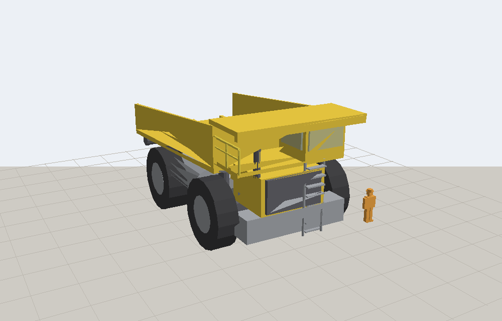

# Mining Equipment AR

Life-size augmented-reality models of opencast mining equipment for Android
phones and tablets. Two machines so far — a 220 t rear-dump truck and a 140 t
hydraulic front shovel — placed on the floor at 1:1, with every major component
tappable and explained.



No app to install for the web version: it runs in Chrome on any ARCore device.

## Quick start

```bash
cd mining-ar/tools
python build.py        # generate models, previews and the catalogue
python serve.py        # serve web/ on your network
```

Open the address it prints — `http://localhost:8000/` on this machine, or the
`192.168.x.x` one on a tablet on the same Wi-Fi. For in-page AR rather than
Google's Scene Viewer, use `python serve.py --https`.

**Not sure what a device supports?** Open `check.html` on it. Do not trust a
Play Store search -- the AR component is often preinstalled and hidden, so a
search finding nothing does not mean the device lacks AR.

**On a device that genuinely has no ARCore**, or for exact-scale desk models,
use marker tracking instead, which needs only a camera:

```bash
python make_markers.py    # vendors AR.js, builds printable markers
```

Print `web/print-markers.html` at 100%, then open `marker.html` on the tablet.
The catalogue page detects which route your device can take and says so.
See [docs/05](docs/05-marker-ar-without-arcore.md).

**Tablet plugged in by USB?** Easiest of all — no Wi-Fi, no firewall, and no
certificate warning, since the tablet reaches the server on its own localhost:

```bash
python usb_tablet.py
```

Only Python 3.9+, numpy and Pillow are needed. No Node, no Blender, no Unity.

## What's here

```
mining-ar/
├── web/                 the Android-facing app (static; host it anywhere)
│   ├── index.html       machine catalogue
│   ├── viewer.html      3-D / AR viewer with part labels, specs, safety notes
│   ├── models/          generated .glb models and preview renders
│   ├── data/            specs, part notes and hotspot anchors
├── tools/
│   ├── glbgen.py        glTF 2.0 / GLB writer -- boxes, cylinders, prisms
│   ├── make_dumper.py   the rear-dump truck, to the published envelope
│   ├── make_shovel.py   the hydraulic front shovel, posed mid-dig
│   ├── figure.py        1.8 m person, for scale
│   ├── render_preview.py offline renderer -- sanity checks and thumbnails
│   ├── make_markers.py  vendors AR.js and builds printable markers
│   ├── usb_tablet.py    serve to a USB-connected tablet via adb reverse
│   ├── build.py         regenerate everything
│   └── serve.py         local http/https server for testing on devices
│   ├── marker.html      marker AR, for devices with no ARCore
│   ├── print-markers.html  printable tracking markers
│   └── vendor/          A-Frame + AR.js, vendored for offline use
├── unity/Scripts/       drop-in AR Foundation scripts for the native app
└── docs/                adding machines, optimisation, Unity, deployment
```

## How the models are made

They are generated from code, not modelled by hand. Each `make_*.py` states the
machine's real envelope as named constants and builds the components from
primitives, which means:

- **Dimensions are auditable.** Every number is in the source next to the part
  it describes, so a colleague can check a figure against a spec sheet instead
  of measuring a mesh.
- **Parts are named and separate.** Each becomes a tappable label in the viewer,
  with its own material, so any component can be highlighted or faded.
- **Moving parts are properly hinged.** The shovel is a real chain —
  `superstructure → boom → stick → bucket → bucket_teeth` — each pivoting about
  its actual joint, so it can be animated in Unity later without re-rigging.
- **Files are tiny.** Around 200 KB and 2 500 triangles per machine, which
  loads in about a second on a mine-site connection.

Current envelopes, checked against published figures for each class:

| | Dumper | Shovel |
|---|---|---|
| Overall L × W × H | 13.2 × 7.67 × 6.53 m | 15.1 × 5.13 × 8.19 m |
| Triangles / size | 2 620 / 231 KB | 2 016 / 179 KB |
| Named parts | 20 | 16 |

## In the viewer

- **View at full size in AR** — places the machine on the floor at true 1:1.
- **Tap any marker or part** — highlights it in the 3-D view and shows what it
  does and why it matters.
- **Person for scale** — a 1.8 m figure beside the machine. The quickest way to
  make a tyre's size land.
- **Specs / Safety tabs** — class figures and the operational points that go
  with each machine.

## Roadmap

1. ~~Web AR, two machines~~ — done, this folder.
2. More machines — rope shovel, dragline, surface miner, drill. See
   [docs/01](docs/01-adding-machines.md).
3. Native Unity app for animation, offline use and interaction logging. The
   models are already rigged for it; see [docs/03](docs/03-unity-ar-foundation.md)
   and `unity/Scripts/`.

## A note on what these are

Teaching models: correct overall envelope, correct part breakdown, simplified
geometry. They are for showing people how big a machine is and what it is made
of. They are not engineering models and must not be used for clearance
calculations, transport planning, dimensional checks or anything where being
wrong by 200 mm matters. Figures given are typical for each machine class and
are marked approximate where manufacturers differ. Safety notes are teaching
points, not a substitute for your site's SOPs, DGMS circulars or statutory
training.
